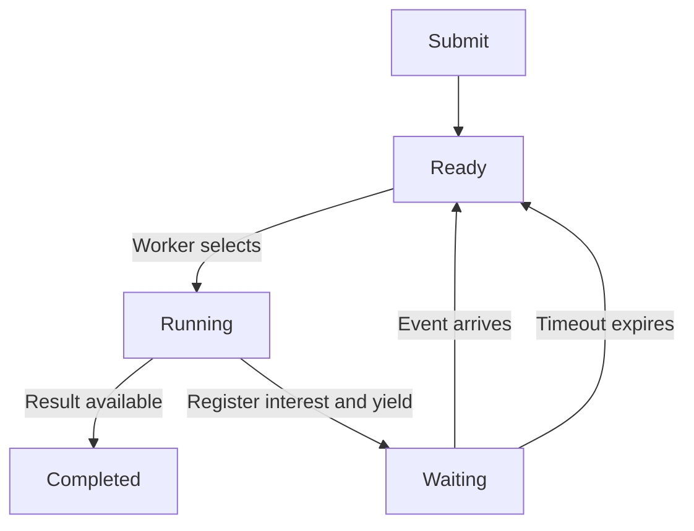

# Job queues, workers, and deadlines

Parent: [Concurrency](concurrency.md).

A scheduler keeps track of work and decides which ready job a worker should take
next. A worker is a goroutine that executes jobs. A job is data describing an
operation plus any state it needs; storing a job does not itself start a goroutine.

This note explains a possible design. It is **exploratory**, not an implemented
framework or an adopted replacement for the current server.

## Ready and waiting are separate states

A queue of jobs ready to execute can simplify ownership: submit adds work, select
claims one ready job, and complete records its result. Waiting adds another state:

| State | Meaning | Needs an executing worker? |
| --- | --- | --- |
| Ready | The next step can run now. | When selected. |
| Running | A worker owns and executes that step. | Yes. |
| Waiting | A condition must change before another step can run. | No, if the job suspends and stores its state. |
| Completed | Work and its cleanup are finished. | No. |

For example, a request for messages can inspect a queue, register interest if it
is empty, save what is needed to resume, and return its worker to the pool. An
event notification or timeout can later move the job back to Ready.



The arrows describe logical state transitions, not goroutine creation. A waiting
job retains state but has returned its worker. A selected job still runs in a
goroutine. Cancellation also needs a defined cleanup path from these states.

If a selected job instead calls a blocking receive and stays inside that call,
its worker remains occupied. Putting that same blocking call behind a job queue
does not change its lifetime. If all ten workers wait for messages, a publisher
using the same pool cannot enter until a worker becomes free, perhaps at timeout.

## Deadline, scheduled time, and priority

These describe different rules:

| Term | Example | Effect |
| --- | --- | --- |
| Scheduled time | Try a refresh at 12:00:15. | Work becomes eligible at that time. |
| Deadline | Stop waiting for messages by 12:00:15. | Expiration triggers timeout handling. It does not imply that the response will finish by then. |
| Priority | Prefer job A over job B when both are ready. | Chooses which waiting-in-the-ready-queue job gets the next worker. |

Choosing the ready job with the nearest deadline is called earliest-deadline-first
ordering. A heap is one way to keep the next job easy to select; Go provides
[container/heap](https://pkg.go.dev/container/heap) and a priority-queue example.
This ordering alone cannot guarantee deadlines: workers can already be busy,
jobs can take too long, and arrival rates can exceed capacity. A simple worker
pool does not interrupt a running job when a more urgent job arrives.

Jobs without deadlines need a selection policy too. Always favoring approaching
deadlines can indefinitely delay other work under sustained load. A first
prototype can use arrival order among ready jobs while treating deadlines as
separate wakeup triggers; add priority when its benefit is concrete.

## A message wait with a 15-second deadline

```text
time 0s: request finds no messages -> register a pending wait, due at 15s
time 2s: a message arrives         -> make response work ready immediately
later:   a worker writes response -> remove the pending wait and timeout entry
```

If no message arrives, expiration at 15 seconds makes timeout-response work ready
instead. The deadline is a fallback; it is not a reason to postpone delivery of
an event that arrived at 2 seconds. Scheduling one job to check again at 15
seconds would delay message delivery.

An implementation could keep waiting records indexed by subscription and a
separate structure ordered by timeout. One coordinator can watch the next timeout
and incoming notifications, using a timer channel. Inserting an earlier deadline
must wake it so it can update its timer. Go's
[NewTimer](https://pkg.go.dev/time#NewTimer) provides a timer channel;
[AfterFunc](https://pkg.go.dev/time#AfterFunc) executes its callback in a goroutine,
so it does not automatically impose a bounded worker pool.

## The synchronization that remains necessary

- Checking the event queue and registering a waiter must be coordinated with
  publication. Otherwise an event can arrive between the empty check and
  registration, leaving a request asleep despite available data.
- An event, timeout, and unsubscribe can race. One synchronized transition must
  decide which path claims the pending response; the others must become harmless.
  Recheck membership and message availability when resumed work requires it.
- Selecting a ready job must atomically claim it so two workers cannot run it.
  Completion, cancellation, and failures must release ownership and pending state.
- Bound pending jobs as well as workers. Stored requests, payloads, and open
  connections consume resources even when they have no dedicated goroutine.
- Socket reads and writes can still block workers. A job scheduler does not
  automatically supply socket readiness, network deadlines, or response ordering.

## Reserving workers for different request types

A server can split its capacity into separate groups: for example, two handlers
for event requests and eight for publication, subscription changes, and files.
This is resource isolation: waiting event requests cannot take the other eight
slots, assuming dispatch into one group does not block dispatch into the other.

With blocking request handling, each event worker serves one outstanding poll:

| Situation | Two reserved event handlers | Eight other handlers |
| --- | --- | --- |
| Alice and Bob poll quiet topics | Both occupied, potentially until timeout. | Available for other requests. |
| Charlie polls a topic with queued messages | Charlie must wait for an event handler. | Cannot serve Charlie under a strict split, even if idle. |

Using one or five event handlers changes the threshold, not the behavior. A
single goroutine blocked waiting for Alice's queue cannot simultaneously service
Bob's request. This follows from the blocking
[select rules](https://go.dev/ref/spec#Select_statements).

The advantage is a clear, small concurrency budget. The tradeoffs are limited
simultaneous long polls, delayed service for additional subscribers, and reserved
capacity that the other group cannot borrow. A deliberately small application
can choose these limits explicitly; they are observable behavior changes.

One event coordinator can instead manage many pending requests, but it must save
their state and react to messages/timeouts without blocking on any one request.
That is an event loop with much of the explicit lifecycle described above.
Spawning a separate goroutine for each wait also supports more polls, but the
reserved coordinator count no longer bounds those waiting goroutines.

Dispatch adds another consideration: a raw TCP connection's request type becomes
known only after enough HTTP input has been read. A full event queue must not
block the sole accept/dispatch loop and prevent publishers from reaching their
otherwise free workers. Parsing concurrency, queued connections, and slow readers
still need an explicit policy.

## Comparison with a parked request goroutine

With the synchronous approach, the goroutine's stack retains where to resume;
`select` waits for a message, cancellation, or timeout. A worker framework that
truly releases the worker must store this continuation explicitly: the operation
to perform next and the values it needs. It replaces implicit stack state with
explicit job state, ownership rules, and cleanup.

Both designs can be understandable. A job state machine makes waiting visible,
but introduces infrastructure. Retaining parked request goroutines uses Go's
existing waiting mechanism. Merely having many goroutines is not evidence that
one design will perform better; choose a workload and measure the relevant costs.

The [waiting/admission note](waiting-goroutines-and-admission.md) explains how a
goroutine can retain its stack while releasing admission. The
[pub-sub note](publish-subscribe.md) explains queues and long polling. For the
current project scope and its simpler implementation, see the
[Lab 1 broker walkthrough](../../../labs/lab1/docs/DESIGN.md#pub-sub-broker).
