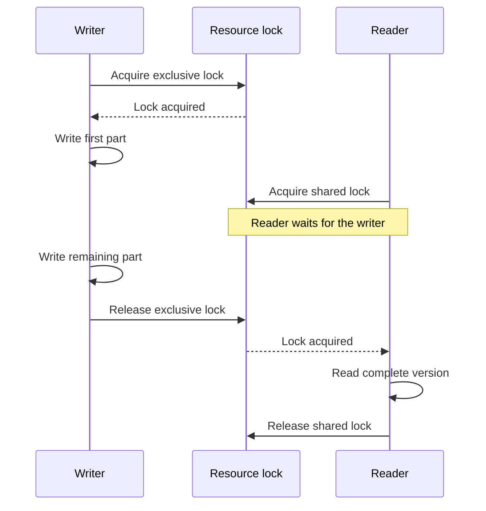

# Keyed locks, atomic operations, and backpressure

Parent: [Concurrency](concurrency.md).

Read [mutexes](mutexes-and-races.md) first. A **keyed lock registry** associates
each resource key with a lock. Two operations on `document-A` share one lock;
an operation on `document-B` can proceed independently. The registry needs its
own synchronization because looking up or creating entries is also shared work.

## Keep a lock alive while anyone depends on it

Suppose a writer owns a lock and a reader is already waiting on it. Deleting the
entry as soon as the writer finishes could let a newcomer create a different
lock for the same key. The old waiter and newcomer could then both run while
believing they are synchronized.

One solution is reference counting: count both holders and waiters before waiting
on the resource lock, and remove an entry only when that count reaches zero.
Release the registry lock before waiting on the resource lock or running a
callback. This avoids blocking unrelated resources behind one busy key.

## Define the complete atomic operation

**Atomic visibility** means another coordinated operation sees a complete state,
not intermediate steps. If updating a file takes several writes, hold its
exclusive lock around the whole update. Readers need the corresponding shared
lock around the whole read. Locking only while opening a file is insufficient.

This sequence shows a reader arriving during a multi-step write to the **same**
resource. The reader waits until the entire write is complete:

Both callers must use the same lock for that resource. A lock for a different
resource does not protect this read or write.

This coordinates participants using that registry and key convention. It does
not automatically synchronize different registries, other processes, or unrelated
programs. It also does not promise crash durability or rollback after a failed
write. Different [path aliases](../files/files-and-paths.md) need an explicit
resource-identity policy.

## Capacity has several dimensions

**Backpressure** means controlling incoming work when processing capacity is full,
for example by waiting for a semaphore permit. Blocking I/O can still occupy a
permit even when it uses little CPU. More connections, larger bodies, and faster
disk access are different scaling questions; measure a concrete workload before
choosing a redesign.

The mutex behavior underlying this pattern is documented in
[sync.RWMutex](https://pkg.go.dev/sync#RWMutex). The registry and reference-count
policy are application-level design choices, not a built-in Go keyed-lock API.
