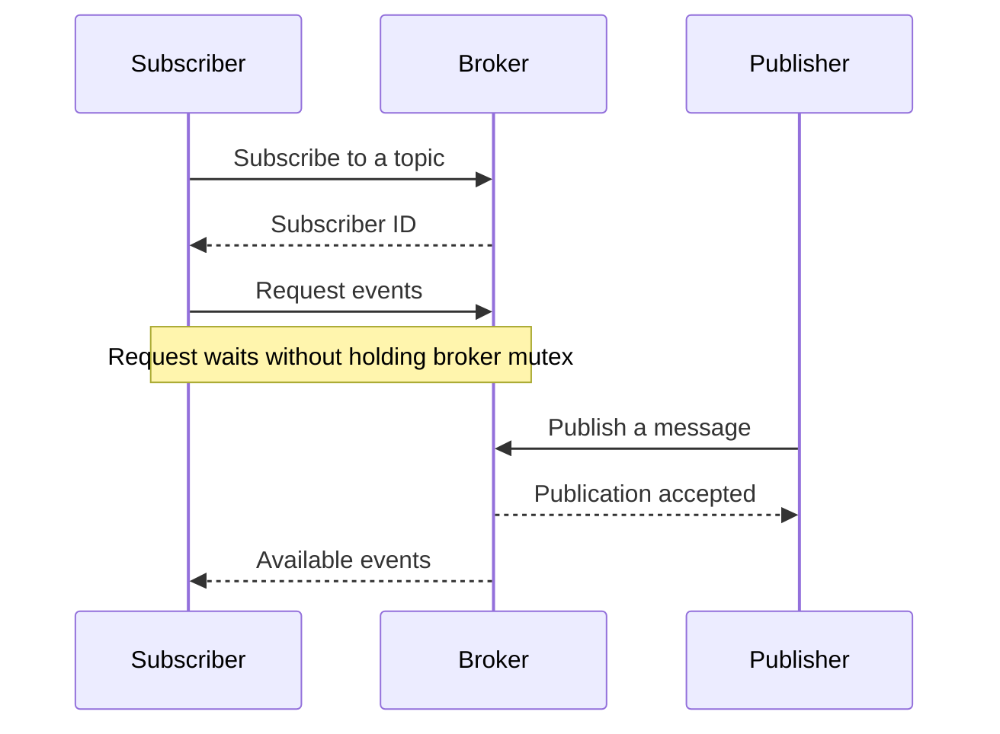

# Publish-subscribe and long polling

Parent: [Concurrency](concurrency.md).

A publisher sends a message to a named topic. A broker delivers it to the topic's
subscribers. Publishers and subscribers communicate through the broker, rather
than needing to know each other.

## Broadcast versus a work queue

A work queue normally gives each job to one worker. A publish-subscribe broker
broadcasts a message to every current subscriber. Separate subscriber queues let
one reader collect its messages without removing another reader's copy.

Bounded queues limit pending messages. A nonblocking send can skip a full queue
so a slow reader does not stop publication to others. This policy permits gaps;
it does not promise that every message will eventually be delivered.

## Order and ownership

Assigning sequence numbers and enqueuing messages under one mutex establishes a
consistent publication order. Releasing the mutex before broadcasting could let
concurrent publishers enqueue in a different order. Never hold that mutex while
waiting for a client or an empty queue to receive a message.

Copy a caller's mutable byte slice before storing it, and avoid exposing retained
slices through the public API. Private fields protect the implementation only
if accessor methods also respect ownership.

## Long polling

A client makes a request that waits for an event or a timeout. The broker replies
on that same connection; the client can then make another request. This needs no
server-initiated connection and no persistent connection across separate polls.

The diagram shows one possible response order, not a requirement that the
publisher's response arrives first. A timeout can return an empty result instead.

A [context](../go/context-and-cancellation.md) supplies cancellation or a deadline to a wait. A separate unsubscribe
signal wakes a reader whose subscription has ended. The queue itself need not be
closed; that avoids a publisher accidentally sending to a closed channel.

Allowing one active polling request per subscriber keeps delivery ordering easy
to reason about. Different subscribers can still poll concurrently. Waiting
requests also consume admission capacity unless the transport explicitly releases
it while waiting and reacquires it before processing the response.

See [channels](goroutines-and-channels.md), [mutexes](mutexes-and-races.md), and
[Go context documentation](https://pkg.go.dev/context) for the underlying tools.
Implementation choices and HTTP payloads belong in the
[Lab 1 pub-sub design](../../../labs/lab1/docs/PUBSUB.md).
