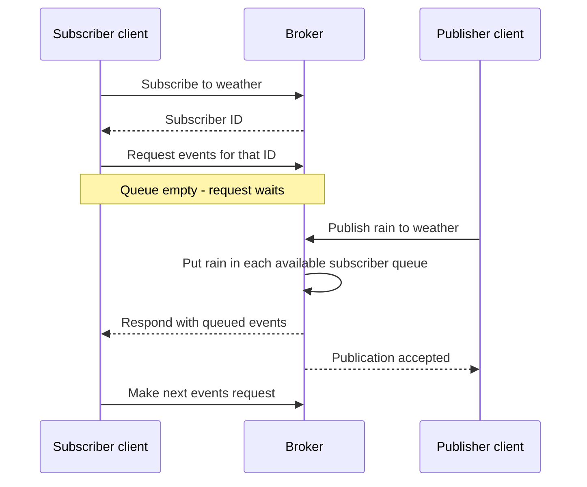

# Publish-subscribe and long polling

Parent: [Concurrency](concurrency.md).

A **publisher** produces messages. A **subscriber** asks to receive messages about
a named **topic**. A **broker** keeps track of those subscriptions and distributes
publications. Publishers and subscribers only need to know the broker's API;
they do not need to discover or connect directly to one another.

For example, a publisher might send `"rain at noon"` to the topic `weather`.
Everyone currently subscribed to `weather` should be offered that publication.
A subscriber to `sports` is unrelated.

## Subscription, queue, and request are different things

It helps to separate three lifetimes:

1. A **subscription** is a record saying an ID belongs to a topic. It can exist
   while the client is doing nothing or is disconnected.
2. A **queue** holds that subscription's pending messages until they are read,
   dropped according to a policy, or discarded when the subscription ends.
3. An **events request** asks to collect messages. With long polling, this request
   can remain open until a message arrives or its wait times out.

Creating a record and a queue does not require a goroutine that constantly watches
them. Publication can put messages directly into each queue. A later events
request can read its own queue, even if no events request existed when the
messages were published.

In a design with one goroutine per HTTP request, an outstanding events request
**does** occupy a goroutine and an open connection. That goroutine can park on
an empty queue. The separate note on
[waiting goroutines and admission limits](waiting-goroutines-and-admission.md)
explains why this need not occupy a dedicated OS thread or an admission permit.

## Broadcast versus a work queue

A work queue normally gives each job to one worker. If Alice and Bob both receive
from the same channel, one received value is removed by one receiver; it is not
automatically copied to both. A publish-subscribe broker instead offers each
publication to every current subscriber.

One straightforward design uses one FIFO queue per subscriber. FIFO means
“first in, first out”: values leave in the order they were added.

```text
publish "rain" to weather
    -> Alice's queue: [rain]
    -> Bob's queue:   [rain]

Alice collects events
    -> Alice's queue: []
    -> Bob's queue:   [rain]  (unaffected by Alice's read)
```

The broker's topic map identifies which queues to visit. The publisher's existing
goroutine can visit them during publication; a background dispatcher is not
required by this design. Other brokers may choose different architectures.

## Bounded queues and slow subscribers

An unbounded queue can grow indefinitely when a subscriber stops collecting
messages. A bounded queue has a fixed number of available slots. The design
then needs a rule for a full queue: wait, reject publication, drop the oldest
message, drop the new message, or something else.

Consider capacity two and a policy that drops **the new message** for a full
subscriber queue:

| Action | Alice's pending queue | Bob's pending queue |
| --- | --- | --- |
| Both subscribe | `[]` | `[]` |
| Publish message 1 | `[1]` | `[1]` |
| Publish message 2 | `[1, 2]` | `[1, 2]` |
| Alice collects both | `[]` | `[1, 2]` |
| Publish message 3 | `[3]` | `[1, 2]`; message 3 is dropped here |
| Bob collects, then message 4 is published | `[3, 4]` | `[4]` |

Bob can observe a gap from 2 to 4. Alice's queue being available does not create
space in Bob's queue. A successful publication can mean “offered to current
subscribers”; it need not mean “every subscriber received it.” State the chosen
guarantee explicitly.

In Go, a bounded channel can serve as the queue. A nonblocking send implements
this particular policy:

```go
select {
case subscriberQueue <- event:
    // A queued slot or waiting receiver accepted the event.
default:
    // No space right now: skip this subscriber for this publication.
}
```

This fragment assumes the queue remains open. It does not wait for queue space;
publication may still spend time acquiring a mutex, copying bytes, and visiting
subscribers. A bound on message count also does not bound payload size or the
total number of subscribers.

## Ordering and payload ownership

If two publishers run concurrently, assigning sequence numbers alone is not
enough. Suppose one publication receives number 1, then pauses before enqueueing;
another publication could enqueue number 2 first. To preserve order in this
simple design, one mutex covers both sequence assignment and queue sends.

The same mutex can protect subscription changes, making “subscribed at the time
of publication” precise: whichever operation obtains the lock first takes effect
first. Release that mutex before waiting for messages so publishers can acquire
it and supply the very messages being awaited.

Payload bytes also need an owner. A Go `[]byte` is a slice referring to mutable
storage. Copying the slice value alone still shares its underlying bytes. Copy
the bytes before retaining a caller's payload, then return copies from accessors.
Private fields prevent direct access; careful accessors prevent indirect mutation.
See [values and slices](../go/values-and-control-flow.md) and
[mutexes](mutexes-and-races.md).

## Long polling: one request, one eventual response

An ordinary poll asks “anything available now?” and can return empty immediately.
A **long poll** asks the same question but waits when the queue is empty. The
server replies on that same client-initiated connection once data or a timeout
is available. The client then starts another request to continue receiving.
Long polling is not an endless response stream.



This is one possible response order. The publisher might receive its response
first instead. Messages arriving between polls can stay in the subscriber's queue;
the subscription outlives each individual request. A poll timeout also need not
end the subscription.

## Waiting, wakeup, and unsubscribe

A typical queue reader waits for one of three things:

```go
select {
case first := <-events:
    // Start a response with this message.
    _ = first
case <-ctx.Done():
    // Timeout or caller cancellation; stop this wait.
case <-subscriptionEnded:
    // Unsubscribe; this ID is no longer valid.
}
```

This fragment assumes `events` stays open and `subscriptionEnded` is a separate
signal channel. It runs in the reader's existing goroutine. No `default` means
it can park when no case is ready. A send can wake it; the publisher does not
call the reader's response function directly. See
[channel waiting](waiting-goroutines-and-admission.md#what-actually-waits).

Closing the separate signal channel wakes a receiver without inserting a fake
message. Another valid design closes the message queue itself: all sends and
the close must be coordinated, for example under one broker mutex, to prevent a
send to a closed channel. Receivers use the second receive value to distinguish
an event from a closed, empty queue. Already-buffered messages remain readable
after close, so membership still needs rechecking before delivery.
After wakeup, recheck membership under the mutex: an unsubscribe may have raced
with a ready message. When multiple `select` cases are ready, there is no promised
priority for the unsubscribe or timeout case.

Once the first event arrives, a reader can collect additional messages already
queued and return a batch. At this stage a nonblocking receive with `default`
means “stop when empty,” rather than waiting for another event. The two selects
have different jobs: wait for the first event, then drain available events.

## One poll at a time and separate responsibilities

Two simultaneous polls for the same subscription could split messages and finish
their responses in a different order. Allowing one outstanding poll per ID makes
delivery order easier to follow. Different subscribers can still poll concurrently.

There may be two relevant lifetimes: the broker finishes collecting messages,
then the transport finishes writing them to the client. A broker-level guard can
protect the first lifetime; an HTTP adapter can extend exclusivity through the
second. A registry entry can represent this claim without holding a mutex while
waiting or writing.

A broker API can expose `Subscribe`, `Publish`, `Events`, and `Unsubscribe` using
ordinary values and errors. An HTTP adapter turns methods/query parameters/body
bytes into those operations and translates their results into status codes and
JSON. This keeps networking rules out of the message-storage implementation.

For context signals, see [context and cancellation](../go/context-and-cancellation.md).
For the small broker now used in Lab 1, including its ordinary ten-handler limit,
read the [Lab 1 walkthrough](../../../labs/lab1/docs/PUBSUB.md).
