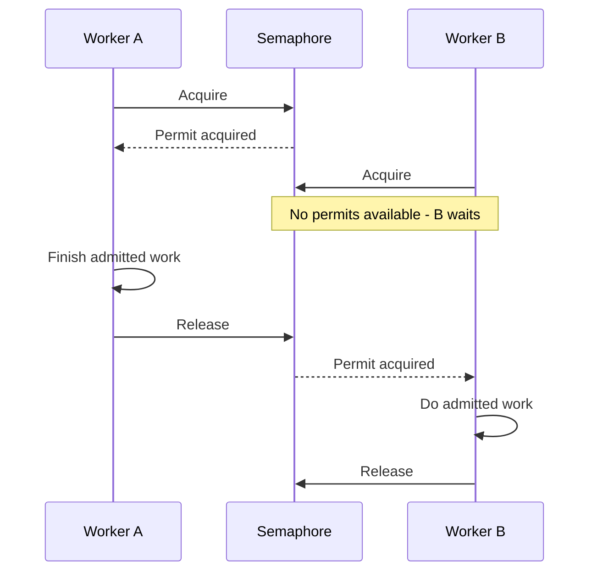

# Semaphores and condition variables

Parent: [Concurrency](concurrency.md).

A **semaphore** manages a number of available permits. Imagine three checkout
counters: at most three customers can be served; others wait for a free counter.

```text
3 available -> acquire -> 2 available -> acquire -> 1 available
0 available -> another acquire must wait
worker finishes -> release -> a waiting worker may proceed
```

An acquire is often called `Down`; a release is `Up`. A mutex protects a critical
section, while a counting semaphore limits the number of concurrent admissions.
The permit count is not a count of all goroutines in the process.

Acquire before starting admitted work. Release when it finishes, including error
paths; `defer` is useful here. Releasing too early defeats the limit, and forgetting
to release can make the system stop admitting work.

## Follow two workers with one permit

This example uses one permit to keep the interaction small. Read downward to
follow time; B's acquire returns only after a permit becomes available:



Waiting does not mean B is consuming CPU continuously. It still has work pending.
A larger initial permit count lets more workers hold permits at the same time.

## Wait for a shared condition

A **condition variable**, Go's `sync.Cond`, lets a goroutine sleep until shared
state may have changed. It works with a lock:

```go
mu.Lock()
for available == 0 {
	cond.Wait()
}
available--
mu.Unlock()
```

Here `cond` must use `mu` as its associated lock. `Wait` atomically releases that
lock while waiting and reacquires it before returning. A release operation changes
`available` under the lock and calls `Signal` to wake a waiter.

Use a loop, not `if`: waking means “check again”, not “you now own a permit”.
Another goroutine may acquire the permit first. `Broadcast` wakes all waiters;
it does not give each one a permit.

See [sync.Cond](https://pkg.go.dev/sync#Cond). A semaphore does not by itself
bound queued connections, input bytes, or how long an admitted worker waits.
Those require separate resource policies.
