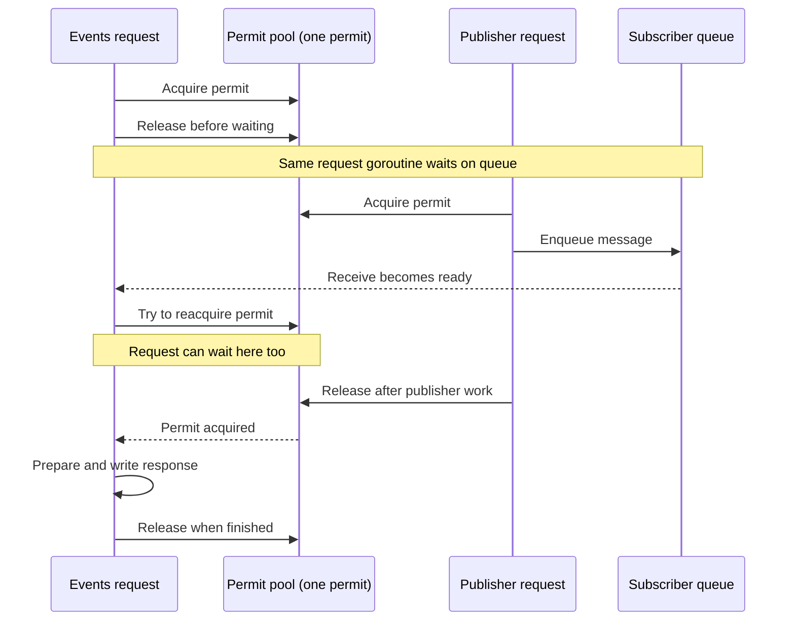

# Waiting goroutines and admission limits

Parent: [Concurrency](concurrency.md).

**A request can release its admission permit and still occupy a goroutine.**
These are different resources. Releasing a permit lets another request enter;
waiting on a channel lets Go run other goroutines while this one has nothing to do.

Read [goroutines and channels](goroutines-and-channels.md) and
[semaphores](semaphores-and-conditions.md) first if those terms are unfamiliar.

## Four things to keep separate

| Resource | What it means | What happens during a channel wait? |
| --- | --- | --- |
| Goroutine | A function's ongoing execution, including its call stack and local variables. | Still exists; it can be parked until a channel operation is possible. |
| OS thread / CPU execution | The machinery that actually executes instructions. Go schedules goroutines onto OS threads. | The parked goroutine needs no dedicated thread to sit checking its channel. Other goroutines can run. |
| Connection | An open communication path to the client. | Remains open if the server intends to reply on it later. |
| Admission permit | Application bookkeeping that allows a request into a limited part of the work. | Remains held unless the application explicitly releases it. Go does not release it automatically. |

Parking means temporarily suspending execution while preserving where to resume.
The runtime can later schedule the goroutine on an available thread. It need not
resume on the same thread. The [Go FAQ](https://go.dev/doc/faq#goroutines) explains
how goroutines share operating-system threads.

A limit of ten permits therefore does **not** imply ten goroutines in the whole
program. The program also has its main goroutine, runtime work, and potentially
requests parked outside that limit. Define what the permits count before using
the limit to make a resource claim.

## What actually waits?

Consider this standalone function; `messages` is a channel owned by its caller:

```go
func receive(ctx context.Context, messages <-chan string) (string, error) {
    select {
    case message := <-messages:
        return message, nil
    case <-ctx.Done():
        return "", ctx.Err()
    }
}
```

This example assumes `messages` remains open. There is no `go` statement, so
`receive` executes in whichever goroutine called it. If neither case is ready,
that goroutine blocks inside `select`. Its caller cannot continue yet, but other
goroutines can. The runtime handles channel wakeups; the application does not
need to create another goroutine that repeatedly checks this one.

When a sender supplies a message or the context's Done channel closes, a case
can proceed. The goroutine becomes eligible to run and eventually continues
through that case. Ready does not mean it immediately gets CPU time. If several
cases are ready, source order does not establish priority. See the
[Go select rules](https://go.dev/ref/spec#Select_statements).

Compare these two patterns:

```go
// Wait when there is no message. The goroutine can park.
select {
case message := <-messages:
    use(message)
case <-ctx.Done():
    return
}

// Try once and continue immediately when there is no message.
select {
case message := <-messages:
    use(message)
default:
    // Nothing available right now.
}
```

These fragments assume `messages`, `ctx`, and `use` exist. A `default` is useful
for a deliberate one-time check. Putting the second fragment inside an endless
loop with no other blocking operation repeatedly checks an empty channel and
wastes CPU. A long wait should normally use the first pattern.

## Why a waiting request can stop publishers

Suppose a server has one admission permit. An events request acquires it and then
waits for a publication. The publisher also needs a permit to enter the server:

```text
events request: holds the only permit -> waits for a message
publisher:      needs that permit     -> cannot publish the message
```

Parking the events goroutine alone does not fix this dependency: it still owns
the application's permit. One possible design lends out that permit around the
channel wait and reacquires it before further admitted work.



This shows one possible schedule with one permit. The events goroutine exists
throughout. It first waits for a message, then may wait for admission. The
publisher's goroutine is a separate request; the wait has not created a helper
goroutine. With more permits, response work can overlap with publisher work.

## Make slot ownership explicit

A small interface can describe the admission operations needed around a wait:

```go
type Slot interface {
    Release()
    Acquire()
}

func receiveWithSlot(ctx context.Context, messages <-chan string, slot Slot) (string, error) {
    if slot != nil {
        slot.Release()
        defer slot.Acquire()
    }
    select {
    case message := <-messages:
        return message, nil
    case <-ctx.Done():
        return "", ctx.Err()
    }
}
```

This example assumes the message channel stays open and the caller owns a slot
on entry. `Slot` describes two methods, not a particular semaphore implementation.
A value with those methods can be passed explicitly; see
[Go interfaces](../go/functions-and-types.md#interfaces-describe-capabilities).
Passing nil represents a direct call without admission accounting.

Read the operations in order: release, wait in select, acquire before returning.
`defer slot.Acquire()` registers a call to run when this function exits; it does
not acquire immediately and does not create a goroutine. Both successful and
error returns must finish that acquisition before their caller can continue.

The same goroutine can first park in select and then park again in Acquire if
other work holds every slot. The slot's method calls are ordinary synchronous
calls. Context separately supplies the deadline/cancellation signal; it does not
need to carry an admission callback.

Keep ownership local to one request goroutine. Do not share its slot with an
independent goroutine that might release it while the owner is doing counted
work. A released slot is available to other requests; it is not reserved for the
original request when it wakes.

## What this design does and does not bound

| Phase of one long-poll request | Request goroutine exists? | Connection open? | Permit held? |
| --- | --- | --- | --- |
| Validate input and inspect state | Yes | Yes | Yes |
| Wait on an empty queue | Yes, parked when no case is ready | Yes | No, if explicitly released |
| Reacquire admission after wakeup | Yes, possibly parked again | Yes | Only when acquire succeeds |
| Encode and write response | Yes | Yes | Yes |
| Finish cleanup | Exits after cleanup | Closed | Released |

This permits many waiting requests while limiting admitted work. It does not
bound the total number of subscriptions, connections, goroutines, queued bytes,
or response-write time. Waiting requests still retain memory and sockets.
Releasing permits alone is not evidence of any measured throughput improvement.

A timeout can stop the queue wait, but it cannot force admission to become
available or a network write to finish. Those stages need their own policies
if an end-to-end deadline is required. Cancellation is cooperative; see
[contexts and deadlines](../go/context-and-cancellation.md).

For an application of these ideas, continue with
[publish-subscribe and long polling](publish-subscribe.md). Lab 1's small broker
keeps its permit while waiting; the release/reacquire design above is optional
background. See the [Lab 1 walkthrough](../../../labs/lab1/docs/PUBSUB.md).
