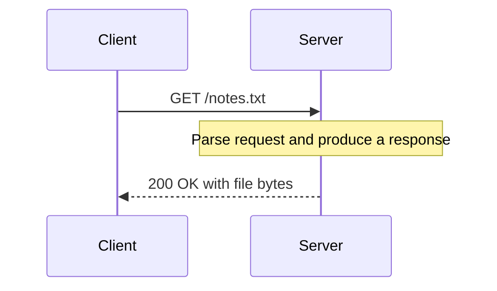

# HTTP basics

Parent: [Networking and HTTP](networking-and-http.md).

**HTTP** defines requests and responses exchanged by clients and servers. For
HTTP/1.1, a simplified request looks like this; actual line endings are `\r\n`:

```http
GET /notes.txt?download=yes HTTP/1.1
Host: localhost

```

The first line has a **method**, a request target, and a protocol version.
Header lines carry metadata; a blank line ends the headers. Some messages then
carry a **body**, such as bytes submitted with POST.

In `/notes.txt?download=yes`, the path is `/notes.txt` and the query is
`download=yes`. A path is not automatically an operating-system filename.
GET asks for a representation of a resource. POST asks the resource to process
submitted content; POST does not universally mean “append to a file”.

## Follow one exchange

Read downward to follow time. This example shows one possible GET exchange:



The client sends a request and the server replies. The response can instead
report a failure; the sequence does not imply that the requested file exists.

## Read a response

```http
HTTP/1.1 200 OK
Content-Type: text/plain
Content-Length: 5
Connection: close

hello
```

`200` is the status code. `Content-Type` describes how to interpret body bytes;
`Content-Length` counts those bytes, not Unicode characters. Content types such
as `text/html` or `image/jpeg` are also called media types or MIME types. The
filename extension is only one way an application might choose that metadata.

Common statuses include 200 success, 400 an invalid request, 404 a missing
resource, and 501 an unimplemented capability. The assignment's specific status
rules are defined in its instructions, not inferred from every general HTTP API.
See [HTTP semantics](https://www.rfc-editor.org/rfc/rfc9110.html).

## Parsing, framing, and connection reuse

**Parsing** turns protocol bytes into structured objects. **Framing** tells a
receiver where the message ends: HTTP/1.1 uses rules involving message type,
length, transfer encoding, and sometimes connection closure. Simply keeping a
connection open does not establish a safe next-message boundary.

In Go, `http.ReadRequest` parses from a buffered reader; the resulting body is
still a stream to consume. `http.Response.Write` serializes a response. Those
operations are different from letting a library own the server's networking.
See [HTTP/1.1 framing](https://www.rfc-editor.org/rfc/rfc9112.html#section-6)
for the full rules.
