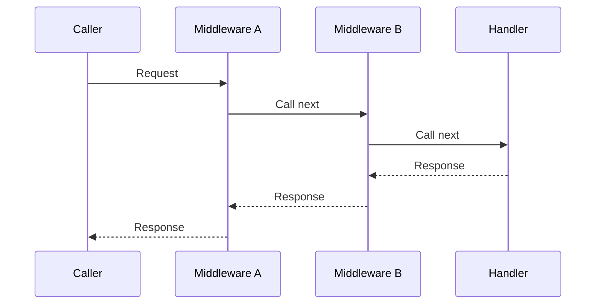
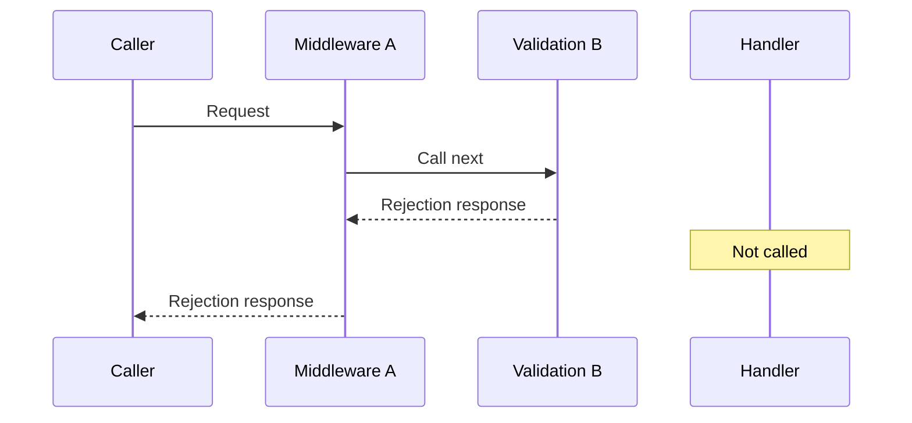

# Routing, middleware, and responsibility boundaries

Parent: [Networking and HTTP](networking-and-http.md).

A **router** chooses what should handle a request. An **endpoint** associates a
recognition rule, often a path, with a **handler** function that produces a result.
Path recognition may use exact strings, prefixes, or [regex](../regex-basics-in-go.md);
regex is a design choice rather than a requirement of routing.

An ordered router tries rules in registration order. A broad rule placed first
can hide more specific rules. A separate **fallback** is considered only after
ordinary routes fail, avoiding an automatically inserted catch-all shadowing
later registrations. Deliberately registered broad routes can still shadow others.

## Middleware wraps behavior

Middleware does something before or after another handler, or rejects the request
without calling it. It is ordinary [function composition](../go/functions-and-types.md):

For the chain `A(B(handler))`, read this sequence from top to bottom. Solid arrows
are calls; dashed arrows are returned responses:

The request enters A, then B, then the handler. Returning unwinds through B,
then A. Each middleware can do work before and after calling `next`. These lanes
show nested function calls, not separate goroutines.

Registering A before B can mean requests enter A first. Constructing that wrapper
chain requires starting from the handler and wrapping B, then A. A path-scoped
middleware only applies where its path rule matches.

A middleware rejecting input **short-circuits** the chain: later middleware and
the handler do not run. Document execution order, matching rules, and whether
fallback requests receive the same middleware; frameworks differ.

For example, B may reject invalid input without calling the handler:

A still receives the rejection from B, so its after-work can still run. The
handler never runs, and any middleware inside B would also be skipped.

## Keep responsibilities explainable

The **single responsibility principle** encourages components to have a clear
reason to change. A generic lock protects access to a key; it need not know which
filename characters an application permits. Input validation enforces those
application rules. Normalization, validation, and authorization are different
tasks; see [files and paths](../files/files-and-paths.md).

Routing chooses behavior, while concurrency control limits how much runs at
once. If configuration changes concurrently, protect the registry and select a
consistent handler/middleware snapshot. Release registry locks before calling
user functions, which may be slow or modify the registry themselves.
