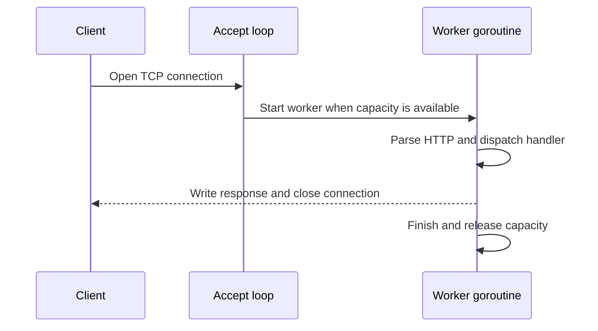
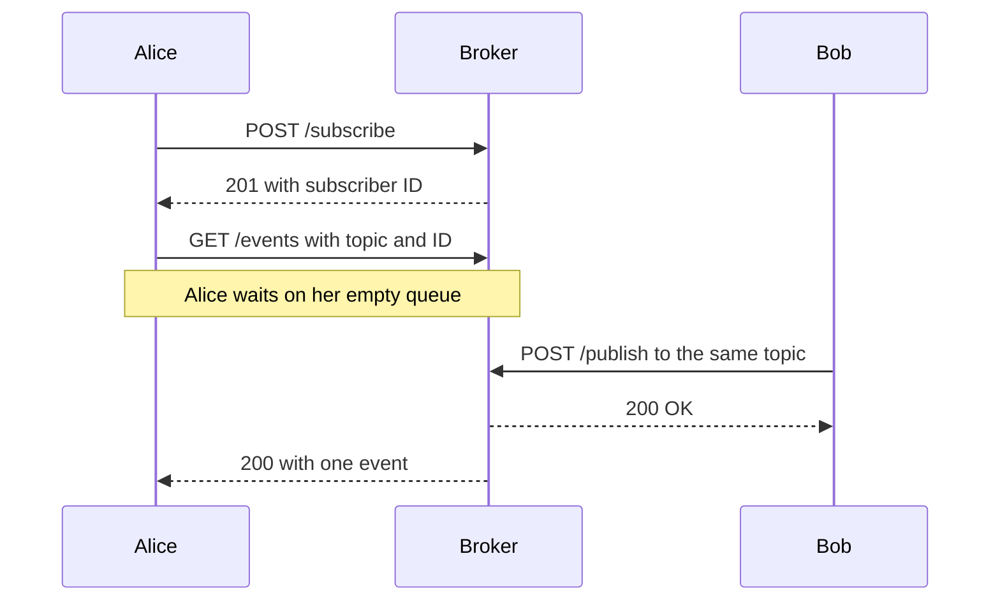
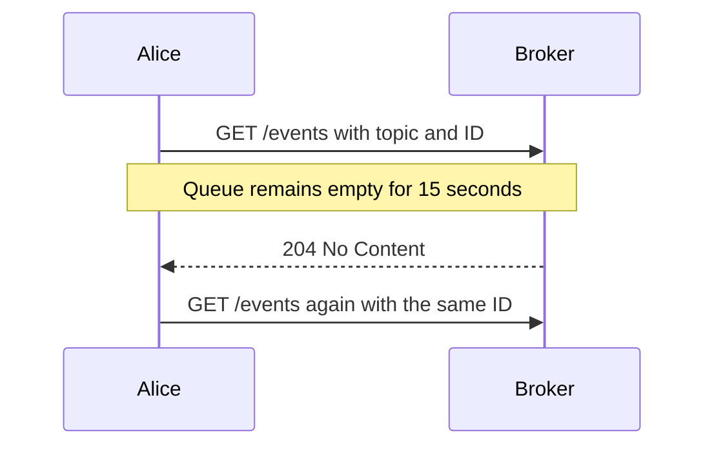

<div class="hero">
<div class="eyebrow">Distributed Systems</div>

# Lab 1 Demo

HTTP file server · Publish–subscribe · Cloud deployment

</div>

<!--
Open with the path one request takes through the Go server. Then show how the same
server handles both a file upload and a subscriber waiting for a message.
-->

---

# Demo agenda

1. **HTTP file server** · Configure endpoints and middleware, trace a request, and demonstrate file access.
2. **Pub-sub service** · Explore subscriber queues, demonstrate long polling, and explain what survives a restart.
3. **Cloud deployment** · Build the Docker image, configure SSH forwarding, and exercise the deployment with the same client.

<!--
Point out the three live checks. First we append and read a file, then we wake a
waiting subscriber, and finally we repeat the file check against the deployment.
-->

---

<div class="hero section-intro">

# 1. HTTP file server

Endpoints · Middleware chaining · Concurrent file access

</div>

<!--
Start with configuration. Separate the reusable TCP server from the Lab 1 handlers
before tracing what happens on an incoming connection.
-->

---

# Endpoint configuration

<div class="cols">
<div class="panel">

### Setup in `main.go`

- Create a server with **up to 10 worker goroutines**.
- Use `RegisterEndpoint` to associate a URL path pattern with a handler.
- Use `SetFallback` to serve files on unmatched paths.

</div>
<div class="panel">

### Endpoint registry

<div v-click class="route"><code>/subscribe</code> → subscribe handler</div>
<div v-click class="route"><code>/unsubscribe</code> → unsubscribe handler</div>
<div v-click class="route"><code>/publish</code> → publish handler</div>
<div v-click class="route"><code>/events</code> → events handler</div>
<div v-click class="route fallback">Fallback → file API</div>

</div>
</div>

<div v-click class="callout">The first matching endpoint wins. The file API handles paths that match none of the registered endpoints.</div>

<!--
Reveal each endpoint and point out that the registry matches URL paths in the order
shown. Reveal the differently colored fallback last. A path like /demo.txt reaches it
because no registered endpoint matches.
-->

---

# A handler takes a request and returns a response

```go
type Handler func(*http.Request) *http.Response

func hello(_ *http.Request) *http.Response {
    return httpserver.NewResponse(200, []byte("Hello world!"), "text/plain")
}
```

<div v-click class="panel">

`RegisterEndpoint("/hello", hello)` associates the path pattern with this example handler. The transport writes the returned response to the connection.

</div>

<!--
Read the Handler signature aloud, then reveal the /hello example. The function
constructs a response and the transport sends it. Use /demo.txt in the live demo
because /hello is illustrative.
-->

---

# Middleware configuration

<div class="middleware-config">
<div class="panel">

### Global middleware

`RegisterMiddleware(".*", middleware.ValidateMethod)`

`.*` matches every path. The method check allows GET and POST.

</div>
<div class="panel">

### File fallback middleware

`Chain(files.Handle, ValidateFilePath, ValidateFileExtension)`

Checks the path and extension before the file handler runs.

</div>
</div>

<div v-click class="callout">Matching global middleware runs in registration order.</div>

<!--
Compare the two scopes. The method check covers every path, including the broker
routes. File path and extension validation wrap only the fallback. Reveal the note
about registration order.
-->

---

# Middleware wraps a handler

<div class="middleware-example">
<div class="middleware-code">

```go {all|4|6}
type Middleware func(Handler) Handler

func ValidateMethod(next Handler) Handler {
    return func(req *http.Request) *http.Response {
        if req.Method != http.MethodGet && req.Method != http.MethodPost {
            return httpserver.NewResponse(501, nil, "")
        }
        return next(req)
    }
}
```

</div>
<div class="middleware-annotations">
  <div v-click="[1, 2]" class="middleware-annotation" style="--code-row: 4">
    <span aria-hidden="true">←</span>
    <span>Returns a function with the <code>Handler</code> signature.</span>
  </div>
  <div v-click="2" class="middleware-annotation" style="--code-row: 6">
    <span aria-hidden="true">←</span>
    <span>Returns early before <code>next(req)</code> can run.</span>
  </div>
</div>
</div>

<!--
On the first click, point to the returned function and explain that it remembers next.
On the second click, show how the 501 response skips next(req). Walk through the last
line for an allowed method.
-->

---

# How chaining works

<div class="burger-example">
  <div class="burger-diagram" aria-label="The file handler sits inside extension validation, with path validation wrapped around both.">
    <div v-click="2" class="burger-layer burger-bun"><span>Path validation · outer wrapper</span></div>
    <div v-click="1" class="burger-layer burger-filling"><span>Extension validation · inner wrapper</span></div>
    <div class="burger-layer burger-handler">File handler</div>
  </div>
  <div class="burger-build">
    <div>Start with <code>files.Handle</code>.</div>
    <div v-click="1">Wrap it with <code>ValidateFileExtension</code>.</div>
    <div v-click="2">Wrap the result with <code>ValidateFilePath</code>.</div>
  </div>
</div>

<div v-click="2" class="callout">
  <code>Chain(files.Handle, ValidateFilePath, ValidateFileExtension)</code> builds<br>
  <code>ValidateFilePath(ValidateFileExtension(files.Handle))</code><br>
  Build from the inside out. A request enters through the outer wrapper first.
</div>

<!--
Reveal extension validation around the file handler, then path validation around both.
A request meets path validation first. The global method check wraps the whole file
fallback separately.
-->

---

# The server under operation

<div class="sequence">



</div>

The semaphore allows **up to 10 worker goroutines** at a time, one per admitted connection.

<!--
Trace the connection from left to right. The accept loop acquires capacity before
starting a worker. The worker parses, dispatches, writes and closes the connection,
then releases capacity for the next worker.
-->

---

# File reads and appends

<div class="cols">
<div class="panel">

### GET `/demo.txt`

Take the file's read lock, read its full contents, and return them with the matching content type.

</div>
<div class="panel">

### POST `/demo.txt`

Read the request body, take the file's write lock, then create or append under that lock.

</div>
</div>

<div v-click class="callout">Each normalized file path has its own lock. Readers of the same file can overlap. A writer excludes readers and other writers for that file.</div>

<!--
Explain why GET can see the file before or after an append, with a complete result
either way. The POST handler reads its body before locking the file. Different paths
have independent locks.
-->

---

# Configure the local demos

<DemoSetup />

<!--
Enter the address and port of the running Go server. Keep Alice and Bob available for
pub-sub. Port 0 picks a free source port, and fixed ports must be distinct if both
clients are active at once.
-->

---

# Live file API

<DemoClient />

<!--
Use a fresh .txt path. Select Plain text, click POST / append, then GET / read and
point out the returned content. Append again to show both values. For the concurrency
check, use the two-writer command in the demo README.
-->

---

<div class="hero section-intro">

# 2. Pub-sub service

Subscriber queues · Long polling · Persistence

</div>

<!--
Introduce a topic as a name subscribers share. Publishing offers an event to each
current subscriber's own queue. The next slides follow both the stored queue state and
the HTTP request that reads it.
-->

---

# Each subscriber has their own queue

<QueueDemo />

<!--
Publish twice, then read once as Alice. Bob keeps both events. Publish twice more and
point out that Bob skips the last event because his queue is full, while Alice still
has room. Reset before repeating.
-->

---

# An event arrives during a poll

<div class="sequence">



</div>

The publisher's request wakes the worker goroutine waiting on Alice's queue.

<!--
Alice subscribes, then starts GET /events on an empty queue. Bob's POST makes an event
available to her waiting worker. Both requests return 200 and their responses can
arrive in either order.
-->

---

# A poll reaches its timeout

<div class="sequence">



</div>

The subscription remains active. Each waiting poll continues to occupy one worker goroutine.

<!--
Walk through silence on the topic. After 15 seconds the server returns 204 and Alice
can poll again with the same ID. Each waiting poll retains one worker, so ten idle
polls can delay a publisher.
-->

---

# Live pub-sub demo

<DemoClient broker />

<!--
Subscribe as Alice and click Poll for event. Switch to Bob and publish to the same
topic. Point out Alice's 200 response and its sequence number. Switch back to Alice
for a 204 timeout, then unsubscribe.
-->

---

# What survives a restart?

| State | Restart the same container | Remove it and create a new container |
| --- | --- | --- |
| Files in `/app/public` | Kept in the container filesystem | Kept if you mount the same volume or host directory |
| Subscriber IDs, queued events, counters | Reset when the process exits | Start empty |

<div class="callout">Mount the same volume at <code>/app/public</code> in the new container to keep the files.</div>

<!--
Compare restarting the process with replacing its container. The broker starts empty
after either. Files persist in the same container, or in a volume remounted at
/app/public when creating a new one.
-->

---

<div class="hero section-intro">

# 3. Cloud deployment

Docker image · SSH forwarding · Live deployment check

</div>

<!--
Explain that the same image runs locally or on an AWS host. Follow the published HTTP
port from Docker to the SSH tunnel, then use the same file client for the deployment
check.
-->

---

# Docker on AWS

<div class="cols">
<div class="panel">

### Inside the image

- Copies the prebuilt Go binary.
- Uses `/app` as its working directory.
- Creates `/app/public`.
- Defaults to `PORT=80`.

</div>
<div class="panel">

### Build and run from `labs/lab1`

```sh
go build -o http_server ./src
docker build -t http_server .
docker run --rm -p 8080:80 http_server
```

</div>
</div>

<div class="callout">Docker publishes container port <code>80</code> on host port <code>8080</code>. The SSH tunnel will forward to that host port.</div>

<!--
Run the commands from labs/lab1 on the build host. Point out why the Dockerfile
creates /app/public and how port 8080 on the Docker host reaches port 80 inside the
container.
-->

---

# Configure SSH forwarding

<SshSetup />

<!--
Fill in the SSH host and user for your instance. Leave the generated command running
in a terminal. The remote HTTP port is the one reachable from the SSH host, 8080 with
the mapping shown.
-->

---

# Configure the deployment server

<DemoSetup deployment />

<!--
Use tunnel for deployment demo fills the local tunnel address and port. For a direct
connection, enter the reachable HTTP or HTTPS address instead. This target is separate
from the local demos.
-->

---

# Live deployment check

<DemoClient deployment />

<!--
Check the server URL shown in the panel. Choose a fresh .txt path, click POST /
append, then GET / read. Show the two 200 responses and the body read back from the
deployment.
-->

---

# Questions and code walkthrough

- Where does the first matching route get selected?
- Why does a waiting poll still count toward the worker limit?
- How does a file lock keep a reader from seeing a partial append?
- What survives when the same container restarts?

<!--
Use the questions to revisit any part the audience wants to see in code. Keep
router.go, server.go, concurrent/files/manager.go, and broker.go ready.
-->
